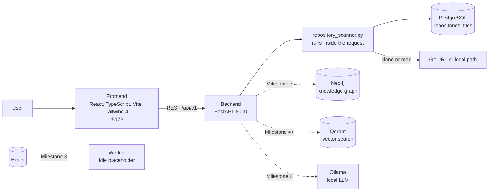
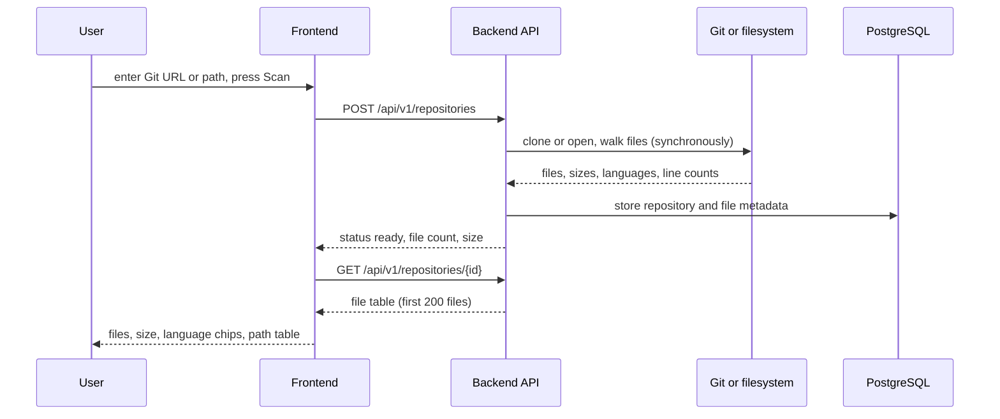

# Architecture and use cases

This repository implements **Milestone 2**: the local platform, repository
ingestion, file metadata scanning, PostgreSQL persistence and a dashboard. The
graph, vector and LLM services are provisioned and healthy but are used by later
milestones.

## System overview

## Ingestion flow (Milestone 2)

## Services

| Service | Port | Role | Status |
|---|---|---|---|
| Frontend | 5173 | Dashboard and repository scanner | Implemented |
| Backend API | 8000 | FastAPI app, OpenAPI docs at `/docs` | Implemented |
| PostgreSQL | 5432 | Repository and file metadata | Implemented |
| Redis | 6379 | Job queue and cache backend | Running, unused until Milestone 3 |
| Worker | n/a | Background job runner | Idle placeholder until Milestone 3 |
| Neo4j | 7474 | Knowledge graph: `CONTAINS`, `IMPORTS`, `CALLS`, `DEPENDS_ON` | Reserved for later milestones |
| Qdrant | 6333 | Vector database for embedding search | Reserved for later milestones |
| Ollama | 11434 | Local LLMs such as Qwen Coder, DeepSeek Coder, Llama | Reserved for later milestones |

## API

| Method | Path | Purpose |
|---|---|---|
| GET | `/api/v1/health` | Service and dependency status |
| GET | `/api/v1/repositories` | List scanned repositories |
| POST | `/api/v1/repositories` | Scan a Git URL or local path |
| GET | `/api/v1/repositories/{repository_id}` | Repository with file metadata |

## Use cases

| Use case | Who | How it helps (today) |
|---|---|---|
| Inventory a repository | Engineer or architect | Scan by Git URL and see file count, size, languages and per-file line counts |
| Keep code analysis on your own machine | Security-conscious team | Everything runs locally in Docker Compose with no paid or cloud dependency |
| Run a local stack in one command | Developer | `docker compose up` brings up the API, UI, database and supporting services |
| Check platform health at a glance | Operator | The dashboard shows each service's status |

**Planned** (per the delivery roadmap): code parsing (Milestone 4), knowledge
graph of dependencies and call chains (Milestone 7), and GraphRAG with local
LLMs for natural-language questions about a codebase (Milestone 8).

For code search, architecture and risk analysis that works today, see the
companion project
[repo-intelligence](https://github.com/Akarshanagoud/repo-intelligence).
